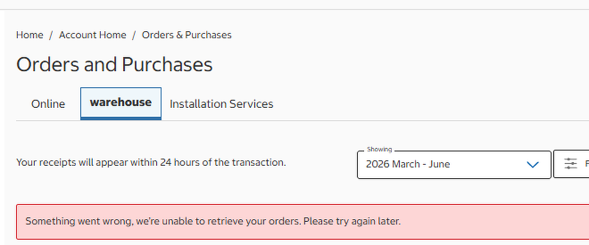
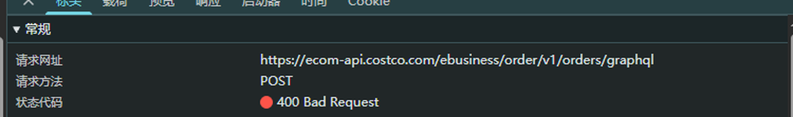
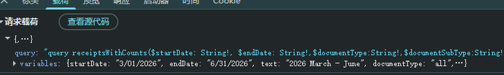
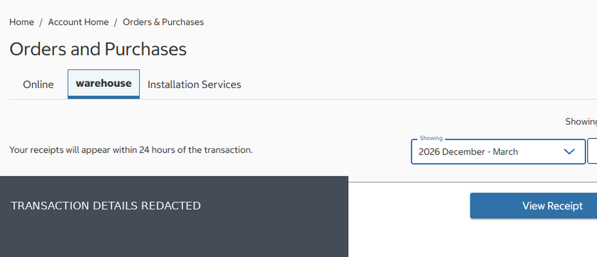

<div align="center">
    
    <h1>Costco-WarehouseHistoryDateFix <code>v1.0</code></h1>
    <p>
        <a href='https://github.com/MehverSynRGB/Costco-WarehouseHistoryDateFix'></a>
        <a href='https://greasyfork.org/scripts/601960'></a>
    </p>
    <p>English | <a href='https://github.com/MehverSynRGB/Costco-WarehouseHistoryDateFix/blob/main/docs/README-zh.md'>简体中文</a></p>
</div>


## Overview

Costco-WarehouseHistoryDateFix is an unofficial userscript for Costco warehouse receipt queries. It has been verified to correct invalid dates in real requests and restore affected queries. For example, it changes the impossible `endDate` below before the request is sent:

```diff
- "endDate": "6/31/2026"
+ "endDate": "6/30/2026"
```

It is not affiliated with or endorsed by Costco Wholesale.

## Features and strict scope

- Targets only `https://ecom-api.costco.com/ebusiness/order/v1/orders/graphql`.
- Handles only `POST` requests for `receiptsWithCounts` and only `variables.endDate`.
- Changes a date only when an `M/D/YYYY` date is impossible for that month; valid dates and every other field are unchanged.
- Covers both `fetch` and `XMLHttpRequest` requests, including the usual browser Axios adapter.
- Does not alter responses, bypass account checks, or extend membership access.

## Install and use

1. Install [Tampermonkey](https://www.tampermonkey.net/) or a compatible userscript manager.
2. Install [Costco-WarehouseHistoryDateFix.user.js](Costco-WarehouseHistoryDateFix.user.js).
3. Ensure the script is enabled, then refresh Costco and open **Account → Orders and Purchases → warehouse**.
4. Retry the affected date range.

## Verification

Open browser DevTools. The Console shows installation and any local correction, for example:

```text
Script Costco-WarehouseHistoryDateFix (Costco-消费历史日期修复) loaded successfully. https://github.com/MehverSynRGB/Costco-WarehouseHistoryDateFix
[Costco Receipt Date Fix] 6/31/2026 -> 6/30/2026
```

In **Network → Fetch/XHR → graphql → Payload**, confirm that the sent `variables.endDate` is `6/30/2026`, then check the HTTP status and page result. The script has restored queries affected by invalid dates, but not every HTTP 400 has this cause.

## Redacted evidence screenshots

All screenshots are privacy-redacted excerpts from troubleshooting.

1. Receipt page error for an affected range:

   

2. The GraphQL request returned HTTP 400:

   

3. The actual request payload contained the invalid date:

   

4. An older range displayed receipt results (transaction details removed):

   

## Privacy and security

The script sends no data to third parties. It does not collect or log receipt details, membership numbers, cookies, or tokens; its console output contains only corrected dates. The included PNG files were cropped and irreversibly redacted. Do not publish raw HAR files, “Copy as cURL” output, session cookies, authorization headers, membership numbers, or unredacted receipt screenshots.

## Limitations and troubleshooting

| Situation | What to check |
| --- | --- |
| The script load message appears but no correction is logged | The date may be valid, the request may not be a purchase history query, or Costco may have changed its request format. |
| The request still contains `6/31` | Confirm the script is enabled and allowed to run on Costco; check for site or userscript-manager changes. |
| The corrected request still returns HTTP 400 | Inspect the response. API, account, authorization, or unrelated parameter issues may remain. |
| Membership expired or identity is not verified | This script cannot restore access or bypass Costco authorization. |

## Disclaimer

Use this unofficial compatibility fix only with accounts and services you are authorized to use. Costco may change its site, API, or access rules at any time. No availability or result is guaranteed.

## License

This project is licensed under the [BSD 3-Clause License](LICENSE).
